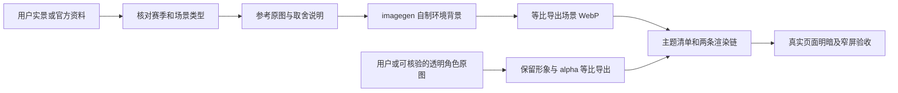

# 赛季主题设计与接入规范

调用链：[项目 AGENTS.md](AGENTS.md) → [roco-season-design Skill](.agents/skills/roco-season-design/SKILL.md) → 本文。也可直接调用 `$roco-season-design`。

本文件是洛克计算器 Web 赛季装饰的可复用执行入口。新增 S5 或调整现有主题时，先读取本文，再核对当前代码和用户本轮要求；它不授权改数据、改正式默认主题、提交、推送或发布。

赛季资料、原图 URL、已有素材来历见 [season-themes.md](docs/design/season-themes.md)；S1–S3 完整生成提示词见 [season-imagegen-prompts.md](docs/design/season-imagegen-prompts.md)。这些文档中的历史验收记录只证明当时结果，不替代本轮验证。尤其不能沿用早期“801–1100px 隐藏 S1–S3 角色”的旧方案。

## 1. 先确定用途，继承已有界面

这是玩家打开即可配置和计算的工具页，主题负责提供赛季辨识度。继承现有标题、精简/具体模式、队伍、工具箱、显示设置、手机操作区和弹窗结构；不另造国际服布局，不新增宣传首屏或说明横幅。只有文字放不下或角色遮挡时，才针对实际尺寸微调。

- 图片分为环境背景、透明招牌精灵、必要的小装饰；文字和控件独立于图片。
- 主题只影响外观，不选择服务器、赛季数据、精灵目录、数值、规则或计算能力；换主题不重置当前配置、队伍、撤销或输入。
- 产品中不堆叠重复的 `CN reference`、`Unverified`、中文占位资料等开发说明。需要解释的真实错误、被禁用操作和数据缺项，在对应操作处保留简明反馈；不能以精简文案为由启用未核验计算。
- 海外版搜索提示不写拼音，但原有拼音/别名等检索能力保留。赛季名称未经确认官方译名时保留原名，不用拼音制造英文名。

## 2. 取证、选图与来源展示

### 先分清素材能证明什么

1. 先看用户提供的游戏实景、原图或明确指定的参考，确认属于哪一赛季、哪个位置。需要核验的赛季名称、时间及代表精灵，用官方公告/PV核对。
2. 参考优先使用官方来源；官方 PV 封面可证明宣传构图与配色，不能自动证明赛季大厅、地图或室内实际布局。需要复刻大厅时，取得对应实机帧或用户实景再设计。
3. 用户记忆与既有方案不一致时，展示两者的原图和出处逐项对照。证据不足就写明缺口，不否定用户记忆，也不让 AI 补出“应该存在”的场景。例如 S1 自制庭院来自 PV 封面延伸，不是已核实的图书馆/大厅复刻。
4. 角色先用用户原色透明图或可核验的高清透明原图。使用社区镜像时标明社区来源及原 URL，不称为“官网直接下载”；不把小头像放大充作全身原图。

每套素材至少记录：赛季与代表精灵依据、原页面链接、实际图片链接、获取日期、来源性质、原文件路径、尺寸/透明通道、采用的视觉元素、衍生处理、运行时文件路径。保留必要来源说明到版本管理文档，不能只依赖被忽略的本机缓存目录。无需为交付另做哈希清单。



选背景看实际窄条裁切是否仍能识别赛季：左侧标题和右侧操作区应安静，主要图形集中在中间偏右。避免主体只在画面最上/最下、文字 Logo 难以裁去、过亮中心、复杂高对比纹样或不可辨认的建筑碎片。选角色看脸部能否放入标题与操作区之间，而不是只看整张原图好不好看。

用户询问来源、怀疑场景或选择方向时，直接展示“参考原图 → 自制背景原稿 → 实际页面裁切”，角色原图单独展示。每张图配短标签说明来源和用途；本地图片用绝对路径内嵌，官方链接指向实际来源。AI 生成图始终标为自制装饰，不能称地图实景、官方原画或官网下载场景。

## 3. 制作资产：场景与角色分开

### 环境背景

按现有 [提示词](docs/design/season-imagegen-prompts.md) 的构图约束，通过实际可用的 imagegen 工具生成；先检查引用图，再传引用图及具体要求。不得声称文档或脚本会自动研究、生成、裁切和发布一整套主题。

- 参考比例约 **3:1**；当前运行时场景为 **2000×667 WebP**。生成可使用更高的同等比例原稿，导出时等比转换，不拉伸；保存原始 PNG。
- 为约 **50px 顶栏**及 **240px 暗色页顶淡出**设计，关键氛围放在原图纵向约 35%–65% 的中段，先预看这一薄条是否成立。
- 左侧约 40% 和最右约 20% 留低对比空间，主要视觉元素可在横向 55%–75%；具体以真实标题/按钮位置为准。
- 背景不包含精灵、角色、文字、数字、赛季字样、Logo、水印、边框或 UI 控件。生成结果含伪字或角色时应修正，不能靠产品叠层掩盖。
- 图像导出使用明确的本地处理步骤，核对尺寸、实际内容与读取成功；不重新生成已经合格的资产。

### 招牌精灵

角色独立使用原透明素材，保留原色、形象、比例和 alpha。仅做必要的等比尺寸/格式转换，不重绘角色，不将角色并入背景生成，不去掉透明通道。当前 S1–S3 使用 512×512 WebP，S4 银月狼王为 486×406；这是现有素材尺寸，不强迫后续角色套同一正方形裁切。

用 CSS 调整角色大小与位置，让脸部在真实页头可辨，身体可以自然裁切；不留下无法辨认的局部，不压住文字和按钮。角色及背景均为纯装饰：`aria-hidden`、图片空 `alt`、禁止指针交互，不增加读屏噪声。

## 4. 接入文件与检查范围

这是每次接入的核对表，不要求无差别修改所有文件；能复用的入口保持不动。新增主题必须检查清单以外的显式赛季选择器，避免只加资产而没有开启暗色层。

| 层面 | 真实入口 | 接入或核对内容 |
| --- | --- | --- |
| 素材与来源 | `public/assets/season/`；[来源记录](docs/design/season-themes.md)；[生成记录](docs/design/season-imagegen-prompts.md) | 场景、角色分开；记录实际依据、衍生处理和原稿位置。 |
| 主题清单与默认 | `src/theme/season-themes.js` | `SEASON_THEMES` 的 scene/character/sourceName；当前 `PREVIEW_IDS` 同时生成可选清单；本地预览白名单和默认解析。不要因为加入 S5 就改 CN 默认 S4 或 Global 默认 neutral。 |
| 偏好状态 | `src/state/season-theme.js`、`src/state/server-storage.js` | 按服务器读写、无效值回默认、存储不可用时当前会话可切换；不新增另一套主题存储。 |
| 运行时 | `src/runtime/WebEntry.jsx`、`src/runtime/RuntimeContext.jsx` | `data-season`、场景/角色 CSS 变量、预览优先级、选择后移除预览参数、语言/服务器切换与当前草稿保护。 |
| 显示设置 | `src/components/DisplaySettingsDialog.jsx` | 复用“赛季主题 / Theme / テーマ”下拉；选项由清单生成；预览单独用禁用占位项，允许选择同一赛季并保存。 |
| 文案 | `src/i18n/common-messages.js` 及相关语言测试 | 操作标签中英日齐全；赛季名称显示 `S1 暗夜拾光` 这类原名，不编官方译名；新增键不得出现 Translation unavailable。 |
| 页头 | `src/components/AppHeader.jsx` | 资产分层、尺寸、装饰语义、短标题与双模式；普通标题仍表示真实工具/数据状态，不把所选装饰写成数据版本。 |
| 主样式 | `src/styles/20-s4-season.css` | 新主题的颜色变量、角色坐标；浅色 DOM 与暗色 `body::before`；所有列举 s1–s4 的通用选择器按需补新主题。文件名沿用，不整份替换。 |
| 二级界面 | `src/styles/22-secondary-season.css` | 队伍、检索、设置、配置库、来源、下载、更新面板标题及空态复用场景；选中标签边线继承颜色。 |
| 基础与断点 | `src/styles/03-base-shell.css`、`src/styles/10-compact-workspace.css`、`src/styles/13-responsive-mobile.css`、`src/styles.css` | 复用原布局；检查样式导入顺序与优先级，避免后写规则覆盖新主题或恢复固定 S4。 |
| 电鹿例外 | `src/features/deer/deer.css`、`AppHeader` 的 `pageTitle` 分支 | 顶栏不显示赛季场景/角色；保留实底、文字和工具操作，仅继承相关颜色。电鹿自身鹿影独立。 |
| 桌面 | `desktop/main.mjs`、`package.json` | 共享 Web 组件和 CSS；Web 验证不等于桌面安装包已重打或安装。 |
| 小程序独立链 | `miniapp/src/assets/season/`、`miniapp/src/components/SeasonBackdrop.jsx`、`miniapp/src/components/AppHeader.jsx`、`miniapp/src/pages/index/styles/season.css`、`miniapp/src/app.config.js`、`miniapp/src/theme.json` | 独立本地资产、样式及系统主题配置，当前保留 S4。Web 加主题不会自动同步小程序；仅在用户包含该平台时改动，并做微信原生验收。 |

### 两条绘制链必须一起调

浅色：`AppHeader` 的场景层 + 透明角色 ``，由 `--season-character-top/left/width` 定位。

暗色：`body::before` 在页顶 240px 叠加渐隐、角色背景、场景背景；页头 DOM 装饰设为透明，并由页头伪元素补过渡。`--season-character-bg-left` 与 DOM 的 `left` 不是同一种坐标语义，不能只改一边；结合图片宽度校正实际位置，避免脸部跳动、重复角色或淡出断层。

| 宽度 | 处理要求 |
| --- | --- |
| 大于 1100px | 角色脸部对准标题与操作区之间的留白；检查真实标题长度，不以空页代替。 |
| 801–1100px | 角色仍应可辨，按每张原图调整尺寸和纵向裁切；必要时使用已有短标题机制。不能为了避开英文标题而笼统隐藏 S1–S3 或新主题招牌精灵。929px 是侧栏场景必验尺寸。 |
| 不超过 800px | 沿用 S4 手机策略：隐藏大角色/星轨/星点，保留低对比场景；不把大图塞入按钮区域。 |
| 不超过 620px | 保留现有竖屏模式单按钮、图标操作和暗色吸顶实底；实际滚动确认正文不透入导航。 |

二级界面的场景保持低透明度、径向渐隐，不增加容器高度和硬边，不让空态装饰抢过操作引导。中性主题必须清除场景、角色和赛季专属点缀。

### 配色不是只换背景

从参考图抽取少量主色，映射现有变量而不是把整页重新设计：顶栏底/上下边线/正文/赛季字、控件背景/边线/文字、选中态、hover、focus、图标、结果文字、二级标签强调，以及页面渐隐。

检查普通、选中、悬停、键盘焦点、展开及禁用状态；文字不能因背景细节失去对比度，选中态和焦点不能只依赖极淡色差。S4 原色为兼容基准，未修改的主题不应被新规则影响。`20-s4-season.css` 还含技能威力口径、结果、能力图标与撤回控件样式，不能整文件重置而删除已有功能适配。

## 5. 主题状态契约

优先级为 **有效本地预览 → 该服已保存选择 → 该服默认**。

- 国服当前默认 S4，Global 当前默认 neutral。国服设置将默认显示为 S4，不额外列“默认”；Global 有“默认（无赛季装饰）”。新主题加入选项不等于成为默认。
- 手动季节偏好通过现有 `createServerStorage` 按 `cn/global` 保存；Global 中英日共用同一服的主题选择。亮/暗为现有独立设置，换赛季不能改它。
- `seasonPreview` 仅识别现有精确回环主机 `localhost`、`127.0.0.1`、`[::1]` 和已登记主题；线上同名参数无效。预览不写偏好，不进入分享协议，不切数据。
- 从预览手动选主题时，删除 `seasonPreview`，保留其余 query、hash 和 history state。当前预览 S1 时，也必须能选正式 S1 并持久化；不能因下拉 value 相同而不触发。
- 切语言保持当前主题，切服恢复目标服自己的偏好；刷新恢复该服已保存选择。选择 neutral 后图片变量为 `none`，不残留上一套装饰。
- 存储禁用时允许本标签切换，不能虚称已持久化。无效或未知主题恢复该服默认，不生成坏图请求。
- 主题变化不修改数据/规则版本、计算结果、已有输入、分享草稿或服务器路由选择；未核验 Global 计算与自动分流的开关与主题无关。

## 6. S5 等后续主题的最小执行流程

1. **核对当前状态和方向。** 看工作树差异、上述入口及现有验收；保护无关改动。确认用户指定的是大厅实景、PV 氛围还是自制概念，保留原 UI/UX。方向已明确就执行，不重复索取同一确认。
2. **取证并选图。** 确认赛季原名、代表精灵及参考场景的证据；展示原图与采用理由。关键场景无法确认时如实保留缺口，不凭生成能力填空。
3. **生成与导出。** 用 imagegen 只做环境背景，透明角色从原图独立导出；留存原稿、来源与实际提示词，检查 50px 裁切和 240px 淡出用途。
4. **接入现有链路。** 增加 assets、清单和预览/可选 ID；给新主题增加必要的配色和角色定位，并核对所有显式主题选择器、暗色层、手机和二级界面。默认规则、数据和功能不随之改动。
5. **验证与修正。** 运行受影响的已有状态/设置测试，用真实页面完成下节的最小验证；只对失败、有改动或新疑点重跑。新增测试覆盖具体漏掉的行为，不为颜色数值写穷举锁定测试。
6. **交付。** 展示参考原图、自制原稿、真实界面和预览链接；说明改动文件、已验证范围与剩余证据缺口。更新来源和提示词文档；不把网页通过写成桌面/微信已验，不默认发布。

新增 S5 时要同时更新现有测试中“s5 为非法值”的夹具，改用仍未登记的 ID；保留非法输入回退断言，不能仅删掉失败用例。当前 `PREVIEW_IDS` 与 `SELECTABLE_SEASON_THEMES` 有直接关系，扩展前先看实际代码，不假定有独立的自动注册流程。

可复制调用句：

> 按项目根目录 design.md 做 S5 赛季主题。先核验赛季、招牌精灵和场景来源，给我看参考原图与灵感；沿用原 UI/UX，把场景和透明角色分开处理，接入两服现有 Theme 设置，完成中英日、390/929/1280 明暗及切换验证。先本地预览，不改变正式默认主题，不提交、推送或部署。

## 7. 最小充分验证与交付证据

### 自动验证入口

| 涉及变化 | 优先复用的测试 |
| --- | --- |
| 清单、默认、预览与存储 | `tests/state/season-theme.test.js`、`tests/ui/season-theme.test.jsx` |
| 选择器、三语、同预览保存 | `tests/ui/season-theme-settings.test.jsx` |
| 运行时、URL 保留、切语言/切服/刷新/草稿保护 | `tests/ui/web-entry.test.jsx` |
| 页头、语义与模式控件 | `tests/ui/header-portrait.test.jsx`、`tests/smoke/app-shell.test.jsx` |
| 真实桌面/手机布局 | `tests/e2e/uiux-desktop-panel.spec.js`、`tests/e2e/uiux-compact-mobile.spec.js` |
| 电鹿例外 | `tests/ui/deer-page.test.jsx` |
| 小程序（仅本轮涉及时） | `miniapp/tests/app-shell.test.jsx`、`miniapp/tests/portrait-css.test.js`，随后微信原生验收 |

主题接入的定向测试可从项目根运行：

```powershell
npx vitest run --config config/vite.config.mjs tests/state/season-theme.test.js tests/ui/season-theme.test.jsx tests/ui/season-theme-settings.test.jsx tests/ui/web-entry.test.jsx tests/ui/header-portrait.test.jsx --maxWorkers 1
```

以上是仓库标准入口。若本机依赖通过 junction 指向另一工作区，遇到已确认的外部 WASM 路径拒绝，可在实际存在时复用本机忽略目录的 `tmp/vite-local-test.mjs` 运行同一组定向用例；不要为本机路径修改产品配置，也不把该临时配置视为仓库依赖。

按本次实际改动增减测试文件。对受影响 JS/JSX 运行现有 ESLint，检查 `git diff --check`；需要生产预览时使用当前 Vite 配置构建并启动预览，不能把旧 dist 当新成果。发布门禁留到获授权发布时执行，文档改动不触发全仓库构建。

### 真实页面必看

- **390、929、1280px，浅色和暗色：** 新主题完整覆盖；逐张读回截图检查脸部、标题/按钮遮挡、裁切、对比度、横向溢出。390px 的角色按现有规则隐藏是预期；929px 不应隐藏。素材 HTTP 加载成功且控制台无本轮新增错误。
- **中英日：** 至少实际打开三语设置并选择新主题；长英文标题和日文控件不能挤压。检查手机设置、队伍/检索等二级标题和空态，不只看首页。
- **真实操作：** 主题下拉逐个切换受影响选项、亮暗切换、精简/具体切换、打开/关闭弹窗、键盘焦点、手机滚动。确认主题层不截获点击。
- **状态边界：** CN/Global 分别保存、切服隔离、Global 切语言保留、刷新恢复、Global 默认清除装饰；本地预览选同主题保存并移除参数，其他 query/hash 保留；配置和已确认的计算结果不变。
- **对照而不重复：** 保留至少一张未改 S4 和中性主题对照；新主题之外只验证受共享样式影响的代表场景。没有新改动/失败，不重复全套截图或测试。

交付保存真实截图与原图/衍生图的明确路径，说明对应视口、主题和语言。先报告用户目标是否实现，再列仍缺来源或未验平台；不以静态无告警、测试数量或构建成功代替视觉和交互通过。
