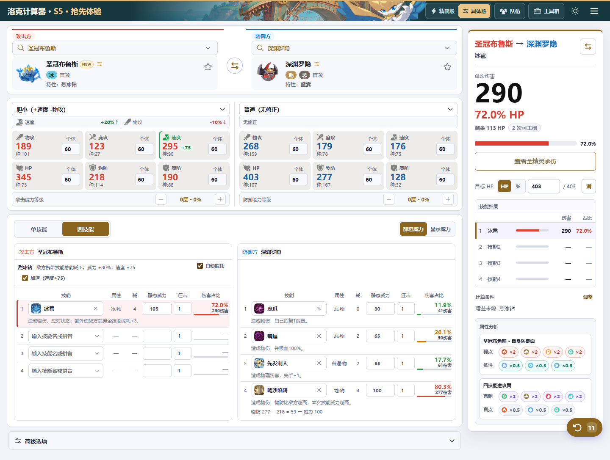
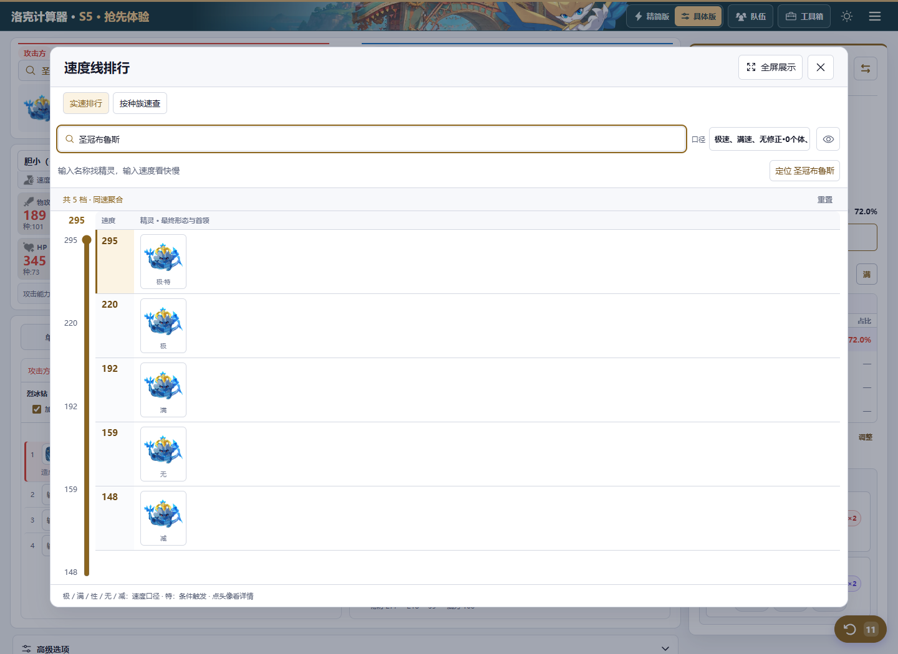

# S5 官号新视频补充资料与验算汇总｜10月31日批次

飞书文档：[查看已发送并回查的汇总](https://my.feishu.cn/docx/C7mtdYsTkos3osxynvkcSmDnnbg)。

整理日期：2026年11月1日。范围：10月31日官号战斗演示补录，以及本轮圣冠布鲁斯加速开关与速度线验收。

本波已补齐28项技能参数、两只首领的正式名称与特性、相关计算适配，并更新到 S5 抢先版 /pre/。19次技能攻击复现中：1次默认配置一致，2次应用画面已知条件后一致，其余16次仅找到额外配置假设下的数值解。

线上入口：[洛克计算器 S5 抢先版](https://rococalc.top/pre/)。本次未更新普通国服和国际服运行版本，未改动或发布小程序，也未发布桌面安装包。

## 首领化与特性补充

| 精灵／特性 | 本次确认与适配 | 默认配招 |
| --- | --- | --- |
| 圣冠布鲁斯／烈冰钻 | 敌方携带技能总能耗每1点，自己攻击威力+10%；总能耗大于15时，速度固定+75。支持自动读取、手填总能耗及独立加速勾选；自动与勾选不重复叠加。 | 冰雹；其余未知槽留空 |
| 琉璃君主／深层侵蚀 | 使用技能后施加中毒，层数等于中毒印记层数的2倍；由已确认的状态计数驱动。 | 血气；其余未知槽留空 |

两只均已补正式名称、官方具名画面抠出的彩色头像与同蒙版剪影。未知首领技能池保持空缺，没有复制普通形态的技能池。

当前计算基线按生命／物攻／魔攻／物防／魔防／速度排列：圣冠布鲁斯为73／101／27／114／88／90，沿用已批准的普通形态基线；琉璃君主为141／37／85／93／136／95，生命141沿用户确认的计算基线，其余沿原形态。视频满血533可由生命141、沉默性格、生命个体60算出，但这不能作为官方完整六维已公布的证明。

## 技能参数、图标与默认配招

下表为本次核对后写入的数据；威力为基础威力，多段技能逐段计算。“—”保持空值，没有自行填入未确认数值。

| 技能 | 属性／类别 | 能耗 | 威力 |
| --- | --- | --- | --- |
| 荒芜之噬 | 龙／物理 | 5 | 130 |
| 咒火 | 龙／变化 | 3 | — |
| 冥暗诅咒 | 幽／变化 | 2 | — |
| 深红龙击 | 龙／物理 | 5 | 115 |
| 矿物置换 | 地／变化 | 1 | — |
| 碎银 | 地／魔法 | 10 | 170 |
| 过充电 | 电／物理 | 2 | 65 |
| 重启 | 电／变化 | 0 | — |
| 离岸流 | 水／物理 | 5 | 125 |
| 续杯 | 水／变化 | 2 | — |
| 蛋壳 | 普通／防御 | 2 | — |
| 筑梦 | 萌／变化 | 7 | — |
| 间歇泉 | 水／物理 | 4 | 115 |
| 外附传播 | 草／防御 | 3 | — |
| 严霜 | 冰／变化 | 4 | — |
| 夏蛰 | 虫／变化 | 4 | — |
| 地缚灵 | 幽／变化 | 2 | — |
| 灵扰 | 幽／物理 | 3 | 25，3连击 |
| 热桥 | 冰／防御 | 2 | — |
| 混合态 | 幻／变化 | 1 | — |
| 投毒 | 毒／物理 | 3 | 90 |
| 画龙点睛 | 龙／变化 | 1 | — |
| 龙之爪牙 | 龙／物理 | 3 | 25，5连击 |
| 蓝移 | 幻／魔法 | 4 | 110 |
| 冷冻 | 冰／物理 | 4 | 100 |
| 果粒 | 草／魔法 | 3 | 45，2连击 |
| 恋恋不舍 | 萌／魔法 | 4 | 110 |
| 维管束重构 | 草／魔法 | 4 | 110 |

四项新增图标均由官方视频原像素裁取，其他图标沿用已核验素材。对应默认四技能的第一格已加入：伊兰亚龙→画龙点睛、翼龙→龙之爪牙、化蝶（平常的样子）→恋恋不舍、格兰球→维管束重构；保留各自其余既有配置。

## 本轮已接通的机制

| 技能或联动 | 当前处理 |
| --- | --- |
| 深红龙击 | 按确认的蓄力历史次数减耗。 |
| 碎银／银头寸 | 累计耗能达到10后永久减耗5；技能与特性共用历史计数。 |
| 过充电／储备金 | 至少聚能1次后永久威力+30；共用所属精灵的聚能计数。 |
| 离岸流 | 至少使用2次水系技能后永久减耗3。 |
| 投毒、灵扰及多段技能 | 投毒按已确认中毒历史增加威力；灵扰基础3连击及确认偷能次数增长；龙之爪牙5连击，果粒2连击。 |
| 严霜 | 施加8层冻结。 |
| 外附传播 | 仅应对攻击成功后施加2层寄生。 |
| 热桥 | 应对攻击成功后，目标魔防-60%。 |
| 地缚灵 | 目标双防-70%；换人条件下速度额外-50。 |
| 画龙点睛 | 确认已完成蓄力或免蓄力后，双攻+80%、速度+30。 |
| 筑梦／霞光梦境 | 天气正式名为“霞光梦境”，持续8回合；沿用后手先行动及铃兰寄生联动。 |

同时修复烈冰钻自动能耗的派生摘要与计算守门不同步、旧聚能／耗能计数迁移误报跨标签冲突。自动读取遇到未知或无效技能能耗时暂停派生加成；已确认0能耗及空槽正常处理，允许明确切换手填。

## 官号视频全部伤害复现

来源为约3分32秒的10月31日官号视频。按约半秒采样检查全片，多段技能另加密读帧；滚动数字、旧浮字残留及能力变化不重复计为伤害。

先用默认配招、普通性格、六项个体60；普通精灵60级，冥古龙按现有界面默认99级，另保留60级参考。再加入可读到的等级、强化、减伤和连击条件。最后才检索额外性格、个体、形态或技能总能耗候选，不跨剪辑串联状态。

“候选”仅表示存在能命中数字的配置解，并非视频实配；没有将这些候选回填为官方种族值或默认配置。

| 时间 | 攻击动作 | 视频伤害 | 默认基线 | 可见条件后 | 候选结果 |
| --- | --- | --- | --- | --- | --- |
| 0:11 | 冥古龙→寂灭骨龙：深红龙击 | 539 | 545 | 545 | 539 |
| 0:19 | 冥古龙→寂灭骨龙：荒芜之噬 | 559 | 616 | 460 | 559 |
| 0:30 | 地绡银龙→晶石蜗：碎银 | 228 | 135 | 135 | 228 |
| 0:37 | 龙嵴金脉→翠顶夫人：过充电 | 253 | 212 | 212 | 253 |
| 0:47 | 阿瓦鲨→权杖-V：离岸流 | 458 | 257 | 386 | 458 |
| 1:00 | 蹦床松鼠→鸡麻麻：音波弹 | 30×4=120 | 64（1段） | 100 | 120 |
| 1:12 | 沙咔蟹→罗隐：间歇泉＊ | 384 | 281 | 281 | 384 |
| 1:17 | 晶石蜗（具体样子未在HUD标出）→沙咔蟹：泥巴喷射 | 6 | 33 | 6 | — |
| 1:24 | 圆环鲸羽→海豹船长：蓝移＊ | 368 | 317 | 317 | 368 |
| 1:35 | 冬虫夏瓜→嗜波螺：果粒 | 164×2=328 | 328 | 328 | — |
| 1:44 | 影子剪纸→夜枭：灵扰 | 139×3=417 | 219 | 372 | 417 |
| 1:53 | 花衣蝶→刨雪鹅：花香 | 11 | 62 | 12 | 11 |
| 2:00 | 刨雪鹅→花衣蝶：冷冻＊ | 270 | 235 | 235 | 270 |
| 2:07 | 滴廿豚→菊花梨：投毒 | 253 | 237 | 237 | 253 |
| 2:21 | 翼龙→寂灭骨龙：龙之爪牙 | 60×5=300 | 295 | 295 | 300 |
| 2:25 | 化蝶（平常的样子）→龙鱼：恋恋不舍＊ | 127 | 172 | 172 | 127 |
| 2:27 | 格兰球→龙鱼：维管束重构＊ | 158 | 137 | 137 | 158 |
| 2:39 | 寂灭骨龙→琉璃君主：龙之利爪 | 73 | 183 | 73 | — |
| 3:04 | 圣冠布鲁斯→深渊罗隐：冰雹 | 726 | 314 | 314 | 726 |

＊间歇泉、蓝移、冷冻、恋恋不舍、维管束重构的完整历史机制尚未接通。表中只用隔离模型计算已知基础伤害；匹配数字不代表网页已支持其全部机制，网页原有计算守门仍保留。

寄生与回复单独结算：视频晶石蜗寄生承伤16、沙咔蟹回复6；默认候选形态的寄生计算为15，合法生命个体候选可算到16。回复6受缺血上限限制，不加进技能直接伤害。

布鲁斯冰雹726的口径：默认对手深渊罗隐携带总能耗8，烈冰钻威力+80%，普通性格下计算314。命中726需额外“对手总能耗30、防方物防个体40”等未证实条件。线上未为了对齐视频把314强改为726。

## 布鲁斯加速开关与速度线线上验收

当前基线、60级、速度个体60：满速192，极速220，极速触发烈冰钻后295；中性满速触发则为267。

- 手动对手总能耗15：不触发加速；16：触发速度+75。
- 独立勾选“加速（速度+75）”可复现加速；与自动条件同时满足时仍只加75。
- 刷新后开关及速度295保留。
- 速度线搜索“圣冠布鲁斯”可见192／220／295；295归入“特殊口径”，需开启该筛选。
- 线上实际操作已通过，图标加载正常，无横向溢出或页面脚本异常。

线上：加速已勾选，速度295，面板显示+75。

线上速度线：295极速触发、220极速、192满速。

## 仍待适配或官方确认

以下12项已录入参数或文本，完整历史／回合机制尚待接通；被标记技能的单技能、四技能及伤害排行不绕过守门输出精确结果。

| 待适配技能 | 缺口 |
| --- | --- |
| 冥暗诅咒 | 扣能与跨回合回复能量。 |
| 矿物置换 | 魔攻变化与禁足的组合。 |
| 重启 | 回合末返场。 |
| 蓝移 | 追加星陨的历史前置。 |
| 冷冻 | 冻结次数与敌方技能能耗增长。 |
| 夏蛰 | 随机奉献。 |
| 混合态 | 随机10层属性减益。 |
| 续杯 | 减耗对应的额外双攻。 |
| 蛋壳 | 应对后的驱散。 |
| 间歇泉 | 按减益层数减耗。 |
| 恋恋不舍 | 减益次数对应的永久威力增长。 |
| 维管束重构 | 累计回复对应的能量回复。 |

- 两只首领官方完整六维、完整技能池仍需后续资料确认。
- 16项伤害候选中的性格、个体、形态与携带技能未在视频证实，后续有面板再校对。
- 当前仍为S4正式快照叠加S5补充，不能当作官方完整S5数据库。

## 来源与发布记录

- [官号10月31日新技能与首领化演示（本波新增依据）](https://www.bilibili.com/video/BV1SNxq6REfb/)
- [首批三家族图鉴（前序录入依据）](https://www.bilibili.com/opus/1263792411026391049)
- [后续家族图鉴（前序录入依据）](https://www.bilibili.com/opus/1263800141975912449)
- [S5抢先体验入口](https://rococalc.top/pre/)
- [已发布提交 e57a2bd](https://github.com/Evenstar-tools/roco-calculator/commit/e57a2bd7a88134231170abc65e6a0cfb206892f0)
- [GitHub发布检查：通过](https://github.com/Evenstar-tools/roco-calculator/actions/runs/41208331883)

资料核对基于已发布的S5固定源码f554e39及官号补录记录；上述界面截图来自10月31日本轮线上验收。旧维护记录中的“本地未发布”属于当时状态，本汇总按本次已完成发布与线上验收更新口径。
